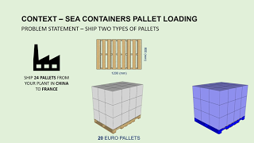

## Containers Loading Optimization with Python 📦
*How can we use heuristic algorithms to find the right strategy to load a maximum number of pallets in a sea container?*

  

### Youtube Video
Find in the link below a short animated explained video to understand the concept behind this solution

  

### Article
In this [Article](https://www.samirsaci.com/containers-loading-optimization-with-python/), we will build a container loading optimization 
model using a heuristic method from a Python library.

### Experiment
#### Scenario
You need to load in a 40' Container
- 20 European Pallets 80 x 120 (cm)
- 4 North American Pallets 100 x 120 (cm)
#### Tentative 1: The Intuitive solution

> Results: 20/20 Euro Pallets loaded, 2/4 American pallets loaded. You need another container for the two remaining pallets.
#### Tentative 2: The Optimization Algorithm Result

> Results: 20/20 Euro Pallets loaded, 4/4 American pallets loaded. You don’t need another container.

## Code
This repository code you will find all the code used to explain the concepts presented in the article.

## Go further

- **The full write-up, with the reasoning behind the code:** [Containers Loading Optimization with Python](https://www.samirsaci.com/containers-loading-optimization-with-python/?utm_source=github&utm_medium=readme&utm_campaign=container-optimization)
- **The video:** [Containers Pallet Loading Optimisation with Python (Source Code)](https://youtu.be/P1kSt3tedI4)
- **Test what you learned:** the [Supply Science App](https://supply-science.com/?utm_source=github&utm_medium=readme&utm_campaign=container-optimization) has a quiz on road transportation and lessons on transportation management, free and in the browser.
- **100+ case studies with their source code:** [samirsaci.com](https://www.samirsaci.com/?utm_source=github&utm_medium=readme&utm_campaign=container-optimization)

## About me

Samir Saci, supply chain engineer and data scientist with ten years in operations across Asia and Europe. Founder of [LogiGreen](https://www.logi-green.com/), creator of [Supply Science](https://www.youtube.com/@SupplyScience).
For consulting on analytics and sustainable supply chain transformation: [LogiGreen](https://www.logi-green.com/). More about me: [samirsaci.com/about](https://www.samirsaci.com/about/) · [LinkedIn](https://www.linkedin.com/in/samir-saci/)

